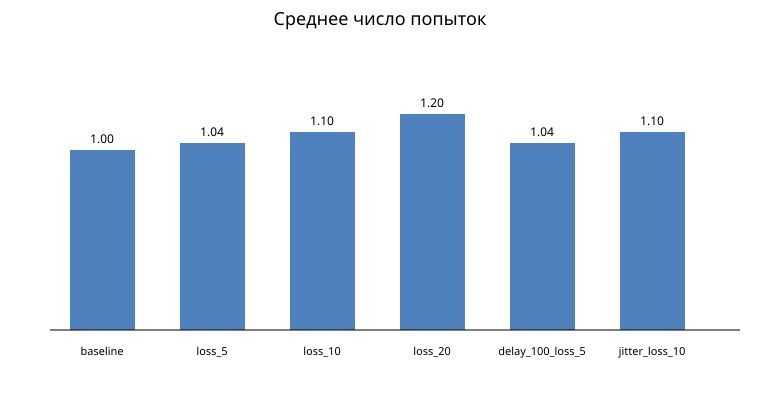
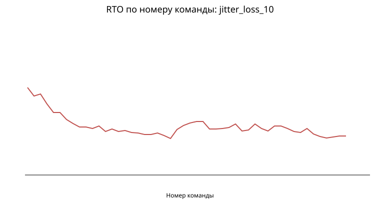

# Отчёт о надёжной доставке UDP

В каждой серии отправлено 50 надёжных команд `SHOOT`. `MOVEMENT` оставлена ненадёжной: устаревшую позицию выгоднее заменить новой, а выстрел нельзя потерять или применить дважды.

| Серия | Ср. попыток | С первой попытки | Не доставлено | Ср. время до ACK, мс | Финальный RTO, мс |
|---|---:|---:|---:|---:|---:|
| baseline | 1.000 | 100.0% | 0.0% | 0.43 | 100.00 |
| loss_5 | 1.040 | 96.0% | 0.0% | 4.39 | 100.00 |
| loss_10 | 1.100 | 90.0% | 0.0% | 10.39 | 100.00 |
| loss_20 | 1.200 | 80.0% | 0.0% | 20.95 | 100.00 |
| delay_100_loss_5 | 1.040 | 96.0% | 0.0% | 104.64 | 100.95 |
| jitter_loss_10 | 1.100 | 90.0% | 0.0% | 105.92 | 156.94 |

## Вывод

При росте потерь растёт среднее число попыток. Повторные ACK игнорируются, повторная команда на сервере подтверждается, но её игровой эффект не выполняется второй раз. Для пакетов с повторной отправкой RTT не используется при обновлении RTO (алгоритм Карна).
